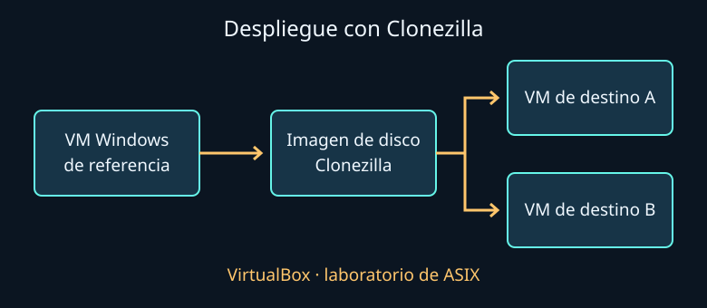

# CV online · Lucas Ruiz

Currículum en HTML y CSS, con experiencia, formación y prácticas de ASIX.

[Ver el CV online](https://lucas-ashy.vercel.app/)

## Vista local e impresión

Abre `index.html` o sirve el repositorio con `python -m http.server 8000`. Comprueba el CV a 390 px de ancho. Para generar un PDF, abre la vista de impresión del navegador, selecciona A4 y elige **Guardar como PDF**.

## Evidencia de ASIX

Diagrama redibujado a partir del flujo descrito en la práctica de Clonezilla. Representa el proceso sin reproducir capturas, direcciones ni datos de equipos.

Los ZIP del CV conservan los materiales originales de Clonezilla, multiboot y PHP.
